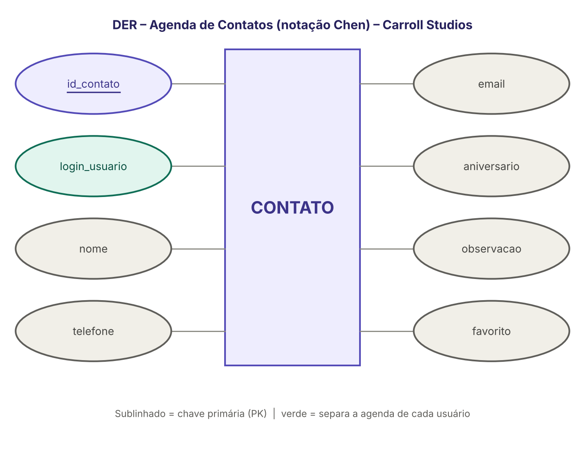
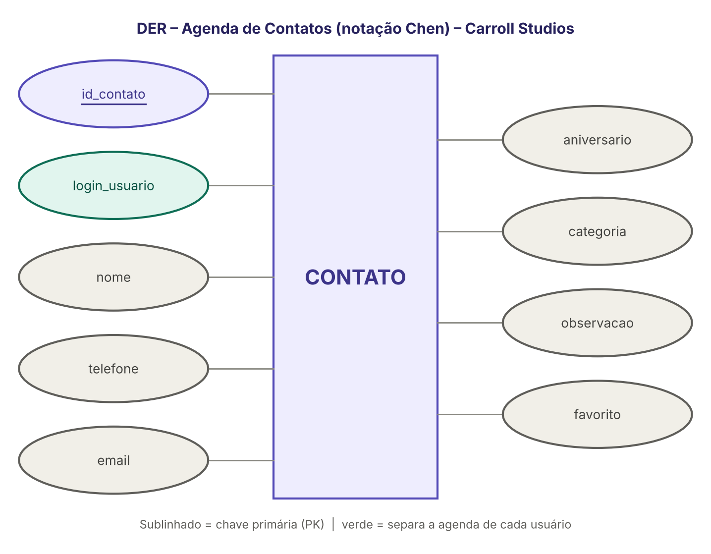
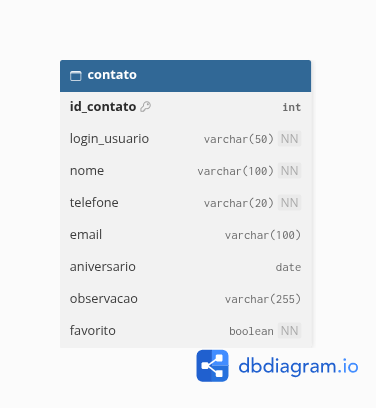

 

✦ agenda-contatos • Carroll Studios ✦

 

Modelagem, estrutura e gerenciamento do banco de dados MySQL da Agenda de Contatos.

 

 

## 🪐 Estrutura

| Pasta | Conteúdo |
|---|---|
| `DER/` | Diagramas Entidade-Relacionamento |
| `DL/` | Diagramas Lógicos |
| `scripts/tabelas/` | Scripts de criação e alteração da tabela |
| `scripts/dados/` | Scripts de inserção de dados |
| `scripts/consultas/` | Consultas SQL e seus resultados |
| `scripts/testes/` | Scripts utilizados nos testes das operações CRUD |

## 📊 Diagramas

### DER — Diagrama Entidade-Relacionamento

**Versão 1:**

**Versão 2 — Atualizada:**

### DL — Diagrama Lógico

**Versão 1:**

**Versão 2 — Atualizada:**

## 💾 Banco de dados

**Nome:** `agenda_contatos`

**Tabela:** `contato`

A tabela armazena as seguintes informações:

| Campo | Tipo | Descrição |
|---|---|---|
| `id_contato` | INT | Identificador do contato (chave primária) |
| `login_usuario` | VARCHAR(50) | Identifica o proprietário do contato |
| `nome` | VARCHAR(100) | Nome do contato |
| `telefone` | VARCHAR(20) | Telefone |
| `email` | VARCHAR(100) | E-mail (opcional) |
| `aniversario` | DATE | Data de aniversário (opcional) |
| `observacao` | VARCHAR(255) | Observações (opcional) |
| `favorito` | BOOLEAN | Indica se o contato é favorito |
| `categoria` | ENUM | Categoria do contato (opcional) |

**Categorias disponíveis:** Trabalho, Família e Amigos.

## 🔐 Regras do banco

- Cada contato pertence a um usuário, identificado pelo campo `login_usuario`.
- Cada usuário possui sua própria agenda.
- Os contatos são separados pelo login do proprietário.
- O banco da Agenda não armazena senhas nem cadastra usuários.
- O campo `id_contato` é gerado automaticamente.
- Os campos de e-mail, aniversário, observação e categoria são opcionais.
- O campo `favorito` possui valor padrão `FALSE`.

## 🔎 Consultas SQL

Foram realizadas diversas consultas para testar o funcionamento do banco de dados.

Entre as principais estão:

- Listar contatos de um usuário.
- Ordenar contatos por aniversário.
- Exibir contatos favoritos primeiro.

Os comandos e resultados estão disponíveis na pasta `scripts/consultas/`.

## 🧪 Testes realizados

Foram realizados testes das operações CRUD:

| Operação | Descrição |
|---|---|
| CREATE | Cadastro de contatos |
| READ | Consulta de contatos |
| UPDATE | Atualização de informações e favoritos |
| DELETE | Exclusão de contatos |

Os comandos utilizados estão documentados em `scripts/testes/testar_crud.sql`.

## ⚙️ Tecnologias

- MySQL 8.0
- SQL

 

✦ Carroll Studios • Agenda de Contatos ✦

