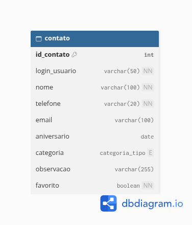

 

✦ agenda-contatos • Carroll Studios ✦

Modelagem, gerenciamento e integração do banco de dados MySQL da Agenda de Contatos.

## 🪐 Estrutura

| Pasta | Conteúdo |
|---|---|
| `DER/` | Diagramas Entidade-Relacionamento |
| `DL/` | Diagramas Lógicos |
| `scripts/` | Scripts SQL, consultas e testes |
| `src/banco/` | Classes Java de conexão com MySQL |
| `src/banco/dao/` | DAO e testes das operações |
| `lib/` | Biblioteca MySQL Connector/J |

## 📊 Diagramas

**DER — Versão 1 e atualizada**

**DL — Versão 1 e atualizada**

## 💾 Banco de dados

**Nome:** `agenda_contatos`

**Tabela:** `contato`

| Campo | Tipo |
|---|---|
| `id_contato` | INT AUTO_INCREMENT (PK) |
| `login_usuario` | VARCHAR(50) |
| `nome` | VARCHAR(100) |
| `telefone` | VARCHAR(20) |
| `email` | VARCHAR(100) |
| `aniversario` | DATE |
| `observacao` | VARCHAR(255) |
| `favorito` | BOOLEAN |
| `categoria` | ENUM |

**Categorias:** Trabalho, Família e Amigos.

## 🔐 Regras do banco

- Cada contato pertence a um usuário, identificado por `login_usuario`.
- Cada usuário possui sua própria agenda.
- O banco da Agenda não armazena usuários nem senhas.
- O identificador do contato é gerado automaticamente.
- E-mail, aniversário, observação e categoria são opcionais.
- Favoritos começam com o valor `FALSE`.

## ☕ Integração Java + MySQL

A conexão é realizada por JDBC, utilizando o MySQL Connector/J.

- `ConexaoMySQL.java`: estabelece a conexão com o banco.
- `ContatoDAO.java`: realiza cadastro, consulta, edição, exclusão e alteração de favoritos.
- `TesteConexao.java` e classes de teste do DAO: verificam o funcionamento da conexão e das operações.

As credenciais ficam no arquivo local `config.properties`, ignorado pelo Git.

## ⚙️ Tecnologias

- MySQL 8.0
- SQL
- Java
- JDBC
- MySQL Connector/J

 

✦ Carroll Studios • Agenda de Contatos ✦

